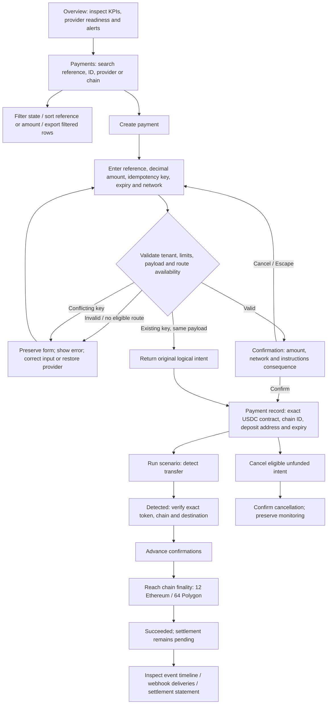
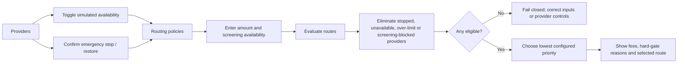

# StableRail payment operations prototype

An executable React + TypeScript operations console derived from `docs/Stablecoin_Payment_Orchestration_Gateway_PRD.pdf` (v1.0, 26 October 2026). Built with `@yaneshtyagi/design-system@1.1.0` and the supplied prd-to-prototype workflow. Development and validation use the local workspace, as explicitly authorized after checking cloud availability.

## Run and validate

Requires Node.js 22.12+ and pnpm 10.20.0.

```sh
pnpm install --frozen-lockfile
pnpm dev
# Open http://localhost:5173
pnpm build       # strict TypeScript check and production Vite bundle
pnpm lint
pnpm test        # domain safety and statement matching tests
pnpm test:e2e    # automated Chrome browser journeys
```

Browser tests default to installed Google Chrome. For bundled Chromium (also used by CI):

```sh
pnpm exec playwright install chromium
PLAYWRIGHT_CHANNEL=chromium pnpm test:e2e
```

Browser tests use isolated contexts and a dedicated local server, or reuse port 5173 when already available. GitHub Actions runs build, lint, unit tests and browser journeys. Screenshots are captured in `docs/screenshots/`. Failed browser tests retain traces in `test-results/`.

State persists under `stablerail.sandbox.v3` in browser localStorage. To reset only this prototype, remove that key in browser developer tools, then reload. Reloading preserves intents, idempotency keys, provider settings, statement references, webhook attempts and audit events. The sandbox clock does not automatically advance expiry or retry jobs; use explicit simulator actions.

## Personas and mapped journeys

- **Head of Payments:** monitor collection health, locate an intent, review its provider and progress, investigate exceptions.
- **Developer / PSP engineer:** create an idempotent intent, inspect exact deposit instructions, simulate events, inspect and replay webhook deliveries.
- **Finance Operations:** compare accepted payments with provider statements, investigate mismatches, append corrective evidence, export reports.
- **Compliance Officer:** inspect screening holds and historical route rationale; mandatory unavailable checks fail closed.
- **Platform administrator:** inspect merchant configuration, switch demonstration tenants, control provider availability, stop future routing and manage illustrative credentials.

### 1. Collection lifecycle



### 2. Exception and recovery paths

| Trigger                               | Screen interaction and state                                                   | Recovery / invariant                                                                                                                  |
| ------------------------------------- | ------------------------------------------------------------------------------ | ------------------------------------------------------------------------------------------------------------------------------------- |
| Partial funding                       | Run underpayment scenario; received amount changes; separate underpayment flag | Additional legitimate funding can satisfy amount; no success below full funding                                                       |
| Excess funding                        | Run overpayment; preserve full received amount and separate overpayment flag   | Operator investigation; no automatic refund                                                                                           |
| Expiry / cancellation + late transfer | Expire or cancel, then record late transfer                                    | Transfer remains traceable; terminal status retained; automatic finality blocked pending review                                       |
| Wrong token                           | Record wrong-token transfer                                                    | Transfer recorded as unallocated; amount never credited                                                                               |
| Duplicate callback                    | Replay duplicate event                                                         | Same observed transfer has no second credit, including after serialization/reload                                                     |
| Provider timeout                      | Run timeout; unknown outcome flag                                              | No cancellation/finality while ambiguous; reconcile original provider outcome; never create second execution                          |
| Chain reorganization                  | Reorg after detection/finality                                                 | Withdraw confirmations, preserve earlier evidence, block finality pending independent chain review; settled records become mismatches |
| Compliance unavailable                | Apply hold or simulate blocked screening on Routing                            | Hard exclusion / execution blocked; CASE-1042 retained; no browser control to release hold                                            |
| Provider outage                       | Toggle availability or confirm emergency stop                                  | Future instructions select eligible alternative; existing instructions and historical decisions remain unchanged                      |
| Settlement mismatch                   | Import a differing provider amount                                             | Mark settlement mismatch; correct using a new statement reference; retain original observation                                        |
| Failed webhook                        | Inspect failed attempt, confirm replay                                         | Same event ID, new delivery attempt and HTTP 200 simulation; financial value unchanged                                                |
| Wrong tenant                          | Switch tenant while viewing another tenant's intent                            | Denied record view; append access-denial audit evidence; return to own payments                                                       |
| List failure / empty results          | Payments list state selector / search with no match                            | Retry or reset filters; preserve records                                                                                              |

Reorg, compliance, wrong-token, and late-payment investigations intentionally stay open when an independent production control would be needed. The prototype does not offer a misleading one-click financial override.

### 3. Routing and provider operations



Bridgeway has priority 1; Orbit Payments has priority 2 and a lower illustrative fee. A cheaper fee cannot override hard gates. Provider configuration is platform-wide; merchant records, statements, endpoints, credentials and exports are scoped to the selected demonstration tenant.

### 4. Finance operations

1. Open Reconciliation from the alert or sidebar; review partial funding, late transfers and statement mismatches.
2. Follow the payment link to inspect original transfers, complete timeline and route snapshot.
3. Open Settlements to inspect succeeded payments separately from their settlement state.
4. Paste the documented three-column CSV and confirm import. All rows are validated before any change is applied. Foreign-tenant or unknown intents, invalid precision, unresolved holds and conflicting provider references reject the import.
5. A matching amount settles the record; a different amount produces a reconciliation mismatch. Re-importing identical provider references is an audited no-op. Corrected statements use a new provider reference and append evidence.
6. Alternatively confirm a matched sandbox statement on a row. This is an explicit simulated external-evidence action; it is blocked for payments awaiting finality or exception review.
7. Export the visible tenant's reconciliation or settlement rows. CSV escaping also neutralizes formula prefixes.

Statement format (replace the ID with a visible succeeded payment):

```csv
intent_id,amount_usdc,provider_reference
pi_example,250.000000,STMT-001
```

The import intentionally supports 1–100 unquoted rows, rather than pretending to implement arbitrary provider statement formats. Unmatched intent IDs reject the entire import with an explicit error; a production unmatched-statement inbox remains future work.

### 5. Webhook operations

1. Open Webhooks; inspect the tenant-scoped sandbox HTTPS endpoint and signature/retry contract.
2. Enter a valid HTTPS URL and save. Invalid URLs keep entered data and show an inline error.
3. Select an event ID to inspect attempt history.
4. Choose Replay event, review the confirmation and confirm or cancel. Successful simulation retains the stable ID and appends an attempt.
5. Return to the intent to correlate event, payment, route and settlement evidence.

### 6. Administration and navigation

- Switch between Atlas PSP / Northstar Commerce and Harbor PSP / Harbor Markets using Active tenant. Lists, exports and endpoints follow that scope.
- Inspect merchant KYB, transaction limit, supported asset/network and policy version.
- Create an illustrative environment-scoped key; confirm revocation before marking it inactive. These masked identifiers are not real credentials.
- Inspect the tenant's operational audit trail. Audit events are append-only in application logic, but browser storage is user-editable.
- Use the sidebar, breadcrumbs, payment links and browser Back/Forward. Global search opens Payments and filters references. Notifications open Reconciliation; Help explains the demo workflow.
- Toggle light/dark theme; use shell navigation overlay on narrow screens. The shared shell supplies keyboard navigation and the confirmation dialogs trap/restore focus.

## Architecture and component tree

```text
ThemeProvider > ToastProvider > AppRoot
└── App
    ├── AppShell (Sidebar + Topbar + responsive content)
    ├── Active tenant / sandbox context
    ├── Overview: PageHeader + KpiRow + Alert + ChartCard + DataTable
    ├── Payments: searchable/sortable DataTable + state previews
    ├── CreatePage: FormLayout + FormGrid + MoneyField + ConfirmDialog
    ├── PaymentDetail: Tabs + instructions + simulator + transfers + Timeline
    ├── RoutingPage: route evaluator + RouteTable
    ├── Providers: availability switches + confirmed emergency controls
    ├── Finance: StatementImport + reconciliation / settlement DataTable
    ├── WebhookPage: endpoint form + event DataTable + attempt Timeline
    ├── Administration: merchant DescriptionList + credential DataTable
    ├── Audit: Timeline
    └── ConfirmDialog + useToast feedback
```

| Hash route         | Purpose                                                                                   |
| ------------------ | ----------------------------------------------------------------------------------------- |
| `#/overview`       | Collection metrics, provider readiness, recent payments                                   |
| `#/payments`       | Search, state filter, sort, export and list-state previews                                |
| `#/payments/new`   | Validated idempotent intent creation                                                      |
| `#/payments/:id`   | Instructions, separate state dimensions, simulator, transfers, routing snapshot, timeline |
| `#/routing`        | Hard-gate evaluation and priority selection                                               |
| `#/providers`      | Overlapping capabilities, health and emergency stop                                       |
| `#/reconciliation` | Exception investigation and statement import                                              |
| `#/settlements`    | External settlement evidence and CSV export                                               |
| `#/webhooks`       | Endpoints, delivery attempts and confirmed replay                                         |
| `#/administration` | Merchant settings and illustrative scoped keys                                            |
| `#/audit`          | Tenant operational audit evidence                                                         |

`src/domain.ts` contains typed entities and pure state transitions. `src/App.tsx` composes the screen components and routes. `src/main.tsx` establishes the required provider order. `src/styles.css` contains only responsive product compositions and token-based utility adjustments. Every core primitive comes from the package root; fonts and styles load once. StatusBadge uses the fixed design system vocabulary, with exact PRD lifecycle labels shown alongside payment badges.

State management uses React state, immutable transitions and versioned localStorage. Monetary values remain decimal strings and arithmetic uses bigint base units; numeric chart conversion is presentation-only. Requests, quotes, deposit addresses, provider health, signatures and compliance responses are simulated. See `docs/API_CONTRACT.md` for the mock boundary and production interface mapping.

## Scope and trade-offs

This implements the controlled POC in PRD §22: one primary merchant, **USDC on two EVM chains**, two overlapping mock adapters, inbound intents, deterministic routing, monitoring scenarios, webhook recovery and reconciliation. A second isolated demonstration tenant exercises access boundaries. USDT (broader MVP scope), payouts, refunds, hosted checkout, fiat FX, treasury, billing and predictive ranking are deferred according to the PRD's release boundaries.

- This is a frontend sandbox, not a live payment gateway. There is no server authentication, database, wallet connection, private key, real provider request, signing secret or fund movement.
- Local tenant scoping demonstrates behavior; it is not a production security boundary. Real RBAC, SSO/MFA, row-level isolation and protected audit storage belong in the server.
- Browser persistence exercises replay and reload, not durable worker crash recovery. Transactional outbox, durable queues, backoff scheduling and cryptographic webhook verification remain server work.
- Hardcoded USDC contracts and chain IDs are illustrative test instructions, not supported production payment destinations. Never send funds to this demo address.
- Fixed sandbox USD/USDC parity is not an executable market quote. Gas, spreads and provider fee estimates are illustrative.
- KYB and approved corridor results are fixed fixtures. Real jurisdiction, sanctions, liquidity, velocity and provider eligibility checks must be implemented and verified independently.
- Expiry and webhook retry clocks are paused and scenarios advance explicitly. Provider unknown-outcome reconciliation returns the original known instruction; it never launches a second operation.
- The PRD's full production definition of done includes legal/provider certification, sandbox/testnet integration, security testing, load/endurance, chaos, backup/restore and disaster recovery. This PR does not claim those production gates.

## PRD acceptance evidence

| Acceptance IDs  | Prototype evidence                                                          | Boundary                                            |
| --------------- | --------------------------------------------------------------------------- | --------------------------------------------------- |
| AT-001 / AT-002 | Same-key replay and conflicting-payload unit tests                          | Browser-local service boundary                      |
| AT-003          | Primary outage selects Orbit; browser journey                               | Simulated provider health                           |
| AT-004          | Timeout locks cancellation/finality; original-outcome reconciliation        | No irreversible execution exists in frontend        |
| AT-005          | Duplicate event leaves one transfer / one recognized amount                 | Deterministic simulator, not chain ingestion worker |
| AT-006 / AT-007 | Late transfer stays on expired intent; wrong token receives no credit       | Independent acceptance/recovery remains manual      |
| AT-008          | Reorg withdraws finality, retains history and blocks restoration            | Independent monitor verification pending            |
| AT-009          | Failed delivery, stable-ID replay, attempt history                          | No actual delivery queue or HTTP call               |
| AT-010          | Screening exclusion despite lower fee                                       | Fixture-based eligibility                           |
| AT-011          | Tenant reads/mutations rejected; denied view audited                        | Production enforcement pending                      |
| AT-012          | Imported amount mismatch and append-only correction tests + browser journey | Narrow mock CSV contract                            |
| AT-013          | Serialized reload preserves duplicate-event behavior                        | Actual worker-crash/queue testing pending           |
| AT-014          | Historical route snapshot and version survive provider changes              | Browser-editable audit storage                      |

Automated browser coverage additionally checks all console routes in both themes, tenant switching, list recovery, mobile overflow, keyboard dismissal and dialog focus restoration. Static preview images are included in `docs/screenshots/`.
