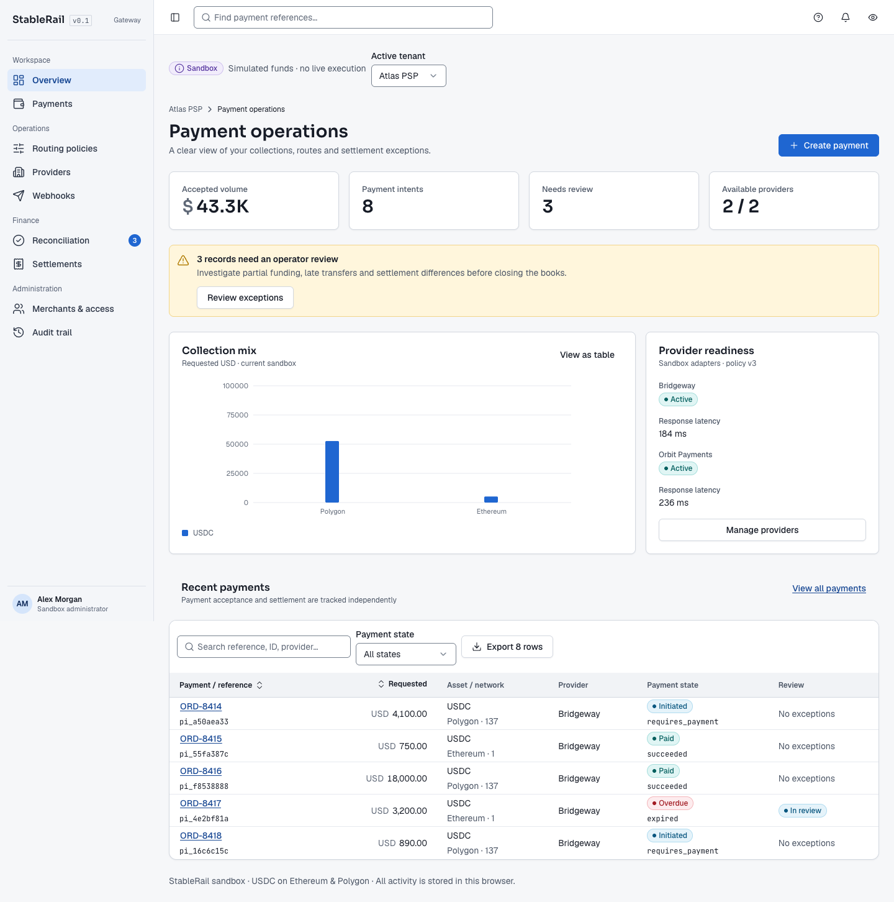

# StableRail

Stablecoin payment orchestration and financial operations prototype.

```sh
pnpm install --frozen-lockfile
pnpm dev
```

Built with React, TypeScript, Vite and `@yaneshtyagi/design-system`. Includes sandbox intent creation, deterministic routing, transfer scenarios, webhook recovery, tenant-scoped operations, statement matching and settlement exports.

See [PROTOTYPE.md](PROTOTYPE.md) for user journeys, validation commands, architecture, acceptance coverage and production boundaries. No live payment or custody integrations are connected.


