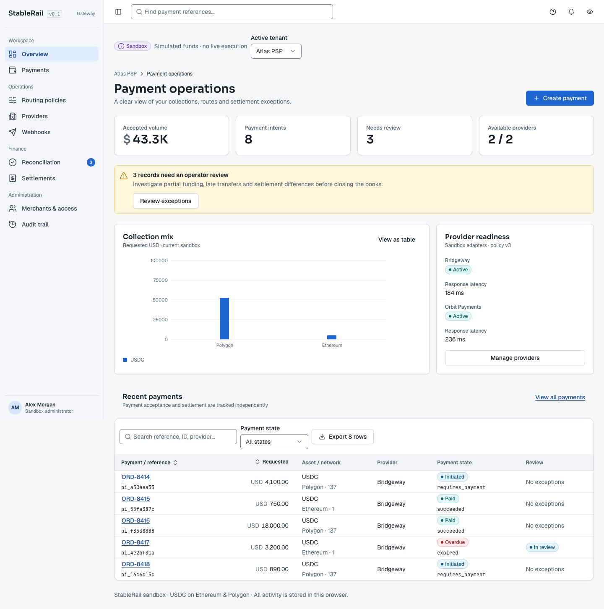

# StableRail

Stablecoin payment orchestration and financial operations prototype.

Repository layout:

- `docs/` — product documentation, screenshots, generated guides and demo artifacts.
- `prototype/` — the current prototype implementation, dependencies and tests.
- `code/` — reserved for the actual product implementation; currently empty.

Run the prototype:

```sh
cd prototype
pnpm install --frozen-lockfile
pnpm dev
```

Open http://localhost:5180.

Built with React, TypeScript, Vite and `@yaneshtyagi/design-system`. Includes sandbox intent creation, deterministic routing, transfer scenarios, webhook recovery, tenant-scoped operations, statement matching and settlement exports.

See [PROTOTYPE.md](docs/PROTOTYPE.md) for user journeys, validation commands, architecture, acceptance coverage and production boundaries. No live payment or custody integrations are connected.



New to payments or stablecoins? Start with the [StableRail domain guide](docs/DOMAIN_GUIDE.md), including worked examples, a glossary, sandbox exercises and a knowledge check.
