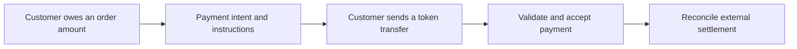
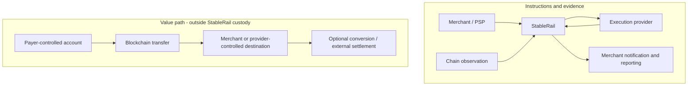

# StableRail domain guide

## A new teammate's introduction to payment orchestration

**Audience:** product, engineering, design, QA, support and operations teammates. No fintech or blockchain experience required.

**Edition:** 1.0 | 27 October 2026 | Based on the StableRail PRD v1.0 and current prototype.

StableRail helps businesses coordinate stablecoin payments across networks and service providers, then explain what happened to each payment. Learning the domain means understanding both the movement of value and the evidence that supports each operational decision.

### What you will be able to explain

- Who pays whom, and where StableRail fits in that relationship.
- Why a payment intent, a blockchain transfer and a settlement are different records.
- How stablecoins, wallets, token contracts and networks work together.
- Why routing, retries, confirmations and reconciliation need careful controls.
- How to investigate the application's common exceptions.

### Choose a learning path

| Time available          | Read and do                                                                |
| ----------------------- | -------------------------------------------------------------------------- |
| 15 minutes              | Chapters 1, 2, 7 and 8; explain the $250 example to a colleague.           |
| 60 minutes              | Chapters 1-18, followed by the guided lab in chapter 19.                   |
| Team onboarding session | Add the glossary, knowledge check and answer discussion in chapters 20-23. |

### How to read this guide

**Domain concept** means a general payment principle. **StableRail design** means the intended product behavior in the PRD. **Prototype behavior** means what this browser demonstration actually implements. These labels matter: a working demo screen does not establish a production control.

All monetary examples are educational. The prototype uses simulated USDC collections on Ethereum and Polygon, fictional providers, paused scenario clocks and browser storage. It does not move funds or connect to live custody, banking or compliance services.

<!-- pagebreak -->

## 1. Start with five distinctions

A customer can owe money before sending it. A transfer can be visible before it is sufficiently reliable to accept. A merchant can accept a payment before its provider finishes settlement. An event can be delivered twice even though the money moved once.

| Keep these separate                        | Plain-language meaning                                                                                          |
| ------------------------------------------ | --------------------------------------------------------------------------------------------------------------- |
| Obligation and movement                    | An order says what is owed. A transfer says what was sent.                                                      |
| Detection and acceptance                   | Seeing a transfer is evidence; accepting it also depends on validation, policy and compliance.                  |
| Acceptance and settlement                  | Satisfying the payment obligation is different from completing the agreed delivery of funds to the beneficiary. |
| Money and messages                         | A webhook reports a change. It does not itself transfer money.                                                  |
| Technical success and business correctness | A valid blockchain transaction might contain the wrong token or pay the wrong destination.                      |

### StableRail in one sentence

StableRail is the coordination and evidence layer that helps a merchant or payment platform create payment instructions, choose eligible providers, monitor transfers, handle exceptions and reconcile settlement.



**Analogy:** think of a logistics coordinator that selects carriers and tracks deliveries. It is not the parcel itself. The analogy has limits: a blockchain transfer already broadcast cannot simply be recalled or handed to another provider.

**Check your understanding:** if a webhook fails, did the payment necessarily fail? No. Notification delivery is a separate fact.

<!-- pagebreak -->

## 2. Meet the participants

| Participant                 | Job                                                                                                                       | StableRail example                                         |
| --------------------------- | ------------------------------------------------------------------------------------------------------------------------- | ---------------------------------------------------------- |
| Payer / customer            | Sends the value for a purchase or obligation.                                                                             | A customer paying an international invoice.                |
| Merchant                    | Sells the product or service and expects payment.                                                                         | Northstar Commerce.                                        |
| Beneficiary                 | The party entitled to receive the agreed funds.                                                                           | Usually the merchant or its designated account.            |
| PSP                         | A payment service provider helping merchants accept or process payments.                                                  | Atlas PSP, the demonstration tenant.                       |
| Execution provider          | Supplies a supported payment, custody, conversion or settlement service. Exact responsibility depends on the integration. | Fictional Bridgeway and Orbit Payments adapters.           |
| Stablecoin issuer           | Issues and redeems a token under its own terms.                                                                           | Circle issues USDC; this is separate from StableRail.      |
| Blockchain network          | Records and validates network transactions.                                                                               | Ethereum or Polygon.                                       |
| Custodian / wallet operator | Controls signing keys under an agreed custody model.                                                                      | An authorized third party in the intended operating model. |
| Finance operations          | Matches records and investigates differences.                                                                             | A teammate using Reconciliation and Settlements.           |
| Compliance team             | Reviews eligibility, screening evidence and cases.                                                                        | A teammate investigating a hold.                           |

A **tenant** is an isolated customer organization in a shared application. A tenant may contain several merchants. A **merchant** is therefore not necessarily the same thing as a tenant, provider or payer.

### A quick comparison with card payments

A card flow may involve an issuer, acquirer, authorization, clearing and settlement. An authorization is permission or a reservation, not necessarily final receipt of funds. A stablecoin flow has different mechanics: signed transfers, network inclusion and chain-specific acceptance rules.

Do not copy a card status directly onto a blockchain event. In particular, the prototype has no card authorization, chargeback network or bank account ledger.

Further background: [BIS CPMI glossary](https://www.bis.org/committees/cpmi/glossary).

<!-- pagebreak -->

## 3. Where value moves, and where instructions move

The intended MVP is **non-custodial**: StableRail does not hold customer assets or private signing keys. Authorized parties handle custody, exchange and fiat payout. StableRail coordinates those relationships and retains operational evidence.



### Three questions to ask in every design review

1. **Who can authorize movement?** Identify the party controlling the signing keys or provider execution authority.
2. **Who owes the beneficiary?** Read the provider agreement and settlement mechanism; a screen alone cannot answer this.
3. **What evidence establishes completion?** It might include a validated on-chain transfer, a provider acknowledgement and a matched settlement statement.

**Custody is about control**, not whether a screen displays a balance. A wallet interface can display assets without StableRail having authority to move them.

**Prototype behavior:** no wallet connection, private key, real provider request or transfer exists. The simulator changes local records. Provider names and the displayed deposit destination are demonstration fixtures, not instructions for sending real funds.

**StableRail design:** non-custodial operation does not by itself decide licensing or regulatory obligations. The actual activities, parties and jurisdictions require a separate launch assessment.

<!-- pagebreak -->

## 4. Blockchain building blocks

A **blockchain** is a shared record maintained according to a network's validation and consensus rules. A **transaction** is a signed instruction submitted to that network. Transactions can be pending, included, unsuccessful or later affected by a change in the accepted chain history.

A **block** groups network activity. A **node** participates in maintaining or reading the network. An **RPC endpoint** is an interface through which software asks a node for information or submits network requests. Two endpoints can temporarily disagree or lag.

### Wallet, address and private key

- An **address** identifies a destination or account within a network's addressing rules.
- A **private key** authorizes signing for a corresponding account. It is not a payment reference.
- A **wallet** is software or hardware for interacting with accounts and signing authority. Assets are represented on the network, not stored as coins inside the app.
- A **seed / recovery phrase** can restore signing access for certain wallet types. It is highly sensitive and must never appear in screenshots, tickets or frontend source.

Ethereum-compatible addresses can look identical across different networks. The same-looking address does not make two networks interchangeable. [Ethereum wallet introduction](https://ethereum.org/wallets/).

### Gas: paying for network execution

**Gas** measures computational work on Ethereum; fees pay for network execution. A USDC transfer can require a separate native-token fee. Failed execution can still consume a network fee. A provider may abstract this from its customer, but someone bears the cost. Gas is not the same charge as StableRail's orchestration fee. [Ethereum gas documentation](https://ethereum.org/developers/docs/gas/).

**Useful question:** when a provider quotes a fee, does it include network costs, or are those charged separately?

<!-- pagebreak -->

## 5. What makes a stablecoin "stable"?

A **stablecoin** is a token designed to track a reference value, often a fiat currency. **Fiat** means government-issued currency, such as USD or INR. A **peg** is the targeted relationship, such as one token aiming to equal one US dollar.

USDC and USDT are different assets with different issuers and terms. The broader PRD discusses both; the controlled prototype demonstrates USDC only.

### A price target is not a promise about every outcome

| Risk                          | What a teammate should understand                                                                                                                            |
| ----------------------------- | ------------------------------------------------------------------------------------------------------------------------------------------------------------ |
| Depeg                         | The market trading price can depart from the target value.                                                                                                   |
| Issuer / reserve / redemption | Access to redemption depends on issuer arrangements, eligibility and terms. Holding a token is not the same as having unrestricted direct redemption access. |
| Freeze or restriction         | Issuer controls or legal orders can restrict an asset or address.                                                                                            |
| Network / smart contract      | Token transfers depend on software, contracts and the chosen network.                                                                                        |
| Custodian / provider          | A third party may be unavailable, insolvent, compromised or operationally delayed.                                                                           |
| Bridged asset                 | A representation created through bridging can add dependencies beyond the native issuer token.                                                               |

Circle's terms describe USDC's target value, conditional redemption and risks. They also distinguish the token from insured bank deposits. Regional terms can differ; use the applicable current documentation. [Circle USDC terms](https://www.circle.com/legal/usdc-terms).

### Native versus bridged

A token natively issued on a network and a bridged representation are not automatically interchangeable. A similar ticker is not evidence of the same asset. StableRail needs an explicit approved asset identity on each supported chain. [Circle's network-specific USDC contracts](https://developers.circle.com/stablecoins/usdc-contract-addresses).

**Prototype behavior:** its fixed USD-to-USDC parity is an illustrative quote, not a live price, redemption facility or return guarantee.

<!-- pagebreak -->

## 6. Identify the exact thing being paid

For an EVM token transfer, operators and software need to agree on at least four things: **network, token contract, destination and amount**. They also need a valid reference, timing and applicable policy.

| Field                          | Why it matters                                                                                       |
| ------------------------------ | ---------------------------------------------------------------------------------------------------- |
| Network / chain ID             | Identifies which ledger to inspect. The prototype uses Ethereum chain 1 and Polygon chain 137.       |
| Token contract                 | Identifies the exact token program on that chain. A symbol such as USDC is only a label.             |
| Deposit destination            | Identifies where the expected transfer must arrive. It is different from the token contract address. |
| Amount and precision           | Defines how many units are owed and observed. Do not silently round away a shortfall.                |
| Transaction hash + event index | Identifies the specific observed transfer event. A single transaction can emit multiple events.      |

**Never confuse the token contract with the beneficiary's deposit address.** Sending to a contract or a wrong network can create a serious recovery problem. The application must not promise recovery just because an address looks familiar.

### Why six decimal places appear

For the USDC model used here, one token has 1,000,000 base units:

```text
250.000000 USDC = 250,000,000 base units
125.000000 USDC = 125,000,000 base units
0.100000 + 0.200000 = 0.300000 USDC
```

The API stores monetary values as decimal strings, such as `"250.00"`. Domain arithmetic uses integer base units. Binary floating-point arithmetic is unsuitable as the financial source of truth because representational errors can affect comparisons.

A fiat display rounded to two decimals and a token quantity retained at six decimals serve different purposes. Preserve both meanings. Official token identities must be verified from the issuer when configuring a real deployment. [Circle contract reference](https://developers.circle.com/stablecoins/usdc-contract-addresses).

<!-- pagebreak -->

## 7. Follow one $250 payment

Northstar Commerce sells a service for **USD 250.00**. Atlas PSP uses StableRail to coordinate its collection. For this sandbox story only, the quote is 1 USD = 1 USDC with no payer amount deduction.

| Step                  | What happens                                                                                  | What that proves                                                                 |
| --------------------- | --------------------------------------------------------------------------------------------- | -------------------------------------------------------------------------------- |
| 1. Create intent      | The merchant submits the obligation, reference, expiry, allowed network and idempotency key.  | A logical payment obligation exists. No funds have moved.                        |
| 2. Choose route       | Eligible providers are evaluated; instructions are issued through the selected provider.      | There is an approved collection route and a destination.                         |
| 3. Send               | The customer independently authorizes a transfer of 250.000000 USDC on the specified network. | An instruction was submitted to the network. Submission alone is not acceptance. |
| 4. Detect and verify  | Monitoring validates chain, token contract, destination and observed amount.                  | A matching observation exists. Compliance and acceptance checks still matter.    |
| 5. Confirm and accept | The configured chain acceptance policy is satisfied and no blocking condition remains.        | The intent can succeed under that policy.                                        |
| 6. Notify             | A webhook reports the state change to the merchant.                                           | A notification attempt occurred; delivery is tracked separately.                 |
| 7. Reconcile          | External settlement evidence is matched to the payment and financial records.                 | The agreed settlement outcome is supported by evidence.                          |

### What might differ in a real integration?

The merchant might retain USDC, or a provider might convert and settle fiat to a bank account. Fees, rate locks, liquidity, bank hours and provider terms can affect the beneficiary amount and timing. Those options are not interchangeable and are not implemented in this prototype.

**Tell it back:** at step 4, can we tell finance that the merchant's bank account has been credited? No. We have a chain observation, not bank settlement evidence.

<!-- pagebreak -->

## 8. Read states without losing meaning

The PRD includes creation followed by `requires_payment`. The prototype issues instructions within creation, so its persistent records begin at `requires_payment`.

| Payment lifecycle value | Plain-language reading                                                               |
| ----------------------- | ------------------------------------------------------------------------------------ |
| `requires_payment`      | Instructions exist; the obligation is waiting for funding.                           |
| `detected`              | A valid matching transfer has been observed.                                         |
| `confirming`            | The transfer is being assessed against the configured acceptance policy.             |
| `succeeded`             | The payment obligation has met the product's acceptance conditions.                  |
| `expired`               | The payment instruction window has ended; monitoring and investigation may continue. |
| `cancelled`             | An eligible intent was cancelled; a transfer already broadcast is not reversed.      |

### Four dimensions on the same record

| Dimension              | Example                                      | Does not mean                                |
| ---------------------- | -------------------------------------------- | -------------------------------------------- |
| Payment                | `succeeded`                                  | External settlement is complete.             |
| Observed funding       | 260.000000 USDC against a 250.000000 request | The extra 10 USDC was refunded.              |
| Compliance / exception | Hold, overpayment or late-transfer review    | The underlying transfer vanished.            |
| Settlement             | `pending`, `settled` or `mismatch`           | The payment lifecycle should be overwritten. |

**Observed amount is not necessarily final accounting recognition.** The prototype's Received USDC total includes valid observed transfers even before acceptance and can retain late funding on an expired intent.

**Finality needs careful language.** Network consensus finality, a provider's acceptance policy and StableRail's business decision are related but distinct. The demo's 12 / 64 confirmation counts are illustrative application thresholds, not a statement that those counts guarantee protocol finality. Ethereum proof-of-stake finality uses checkpoint-based consensus rules. [Ethereum consensus and finality](https://ethereum.org/developers/docs/consensus-mechanisms/pos/).

Detection time and transfer occurrence time can differ. A delayed observation alone does not establish that funding arrived late; inspect chain evidence and the applicable expiry policy.

Shared UI badges such as Paid or Overdue are accompanied by the exact lifecycle label. Use the exact label when discussing a case.

<!-- pagebreak -->

## 9. Routing chooses among eligible options

**Orchestration** means coordinating services and decisions across providers. **Routing** is one part: choosing a valid route for the requested operation.

### First eliminate; then rank

1. Establish the requested asset, chain, amount, merchant and corridor.
2. Eliminate routes that fail mandatory eligibility checks.
3. Rank the remaining routes using the configured policy.
4. Save the policy version, inputs, alternatives and rationale.
5. Revalidate relevant checks before any irreversible execution.

**A corridor** is the relevant origin/destination market and payment arrangement. **Liquidity** is the available funding or conversion capacity to execute the operation. A low fee does not compensate for insufficient liquidity, an unsupported asset or a prohibited corridor.

| Fictional provider | Estimated fee | Priority | Outcome if available and eligible                                        |
| ------------------ | ------------- | -------- | ------------------------------------------------------------------------ |
| Bridgeway          | USD 0.80      | 1        | Selected first under the demo's priority policy.                         |
| Orbit Payments     | USD 0.45      | 2        | Eligible alternative; a cheaper estimate alone does not change priority. |

The prototype dynamically tests provider availability, emergency stops, provider amount limits and simulated screening. Other capability and corridor checks are fixed fixtures, not live verification.

### Safe fallback has a boundary

**Before instructions or execution:** an unavailable provider can be excluded and an eligible alternative selected.

**After a timeout with unknown outcome:** do not infer failure and submit a second irreversible operation. Reconcile the original acknowledgement or execution first. In the demo, this preserves the original instructions.

**After a customer sends to a fixed address:** changing a route in the console cannot redirect that transfer.

A provider emergency stop blocks future eligible routing; it does not erase transfers already on their way.

<!-- pagebreak -->

## 10. Exceptions are operational work

An exception is a fact requiring policy or human review. It is not permission to invent a successful outcome.

| Situation                         | Correct interpretation                                        | First investigation question                                                 |
| --------------------------------- | ------------------------------------------------------------- | ---------------------------------------------------------------------------- |
| Underpayment                      | Some value arrived, but it does not meet the full obligation. | Is more funding expected, or does an approved tolerance apply?               |
| Overpayment                       | More value arrived than requested.                            | How should the excess be held, credited or reviewed under policy?            |
| Late transfer                     | Funding arrived after expiry or cancellation.                 | Does a documented late-acceptance policy apply?                              |
| Wrong token / chain / destination | The expected payment conditions were not met.                 | What exact event was observed, and which party can investigate recovery?     |
| Duplicate notification            | A message may be repeated without new value.                  | Does the network/hash/event identity already exist?                          |
| Unknown provider outcome          | We do not yet know whether the operation committed.           | What original acknowledgement or execution evidence can resolve uncertainty? |
| Chain reorganization              | A provisional observation or confirmation history changed.    | Which chain evidence is now authoritative, and what needs reassessment?      |
| Compliance hold                   | A required control is unresolved or has blocked progress.     | What case reference, decision source and authorized reviewer apply?          |
| Settlement mismatch               | Internal expectations and external evidence differ.           | Is the difference amount, currency, fee, timing, reference or duplication?   |

### A refund is a new transfer

A blockchain refund does not undo the original transfer. The destination must be validated and screened; the original sender could be an exchange or custodian rather than the customer's own wallet. Cumulative refunds must not exceed the approved refundable amount.

Refunds and payouts are later PRD scope and are not implemented in this prototype. Wrong-asset or wrong-network transfers may be unrecoverable; the application should preserve evidence and escalate, not promise a reversal.

**Operational habit:** record what is known, what is uncertain, who owns the next action and which evidence would allow the case to advance.

<!-- pagebreak -->

## 11. Settlement, fees and commercial economics

**Settlement** completes the agreed delivery of funds or discharge of a financial obligation under the relevant arrangement. For this application, external provider settlement is tracked separately from payment acceptance. It need not always mean a fiat bank payout. [BIS payments glossary](https://www.bis.org/committees/cpmi/glossary).

### Gross is not net

Suppose a provider agreement permits a USD 0.80 fee deduction from a USD 250.00 settlement, and this example has no FX difference or additional charges:

```text
Gross settlement value                 USD 250.00
Less contractually deducted fee        USD   0.80
Expected net beneficiary amount        USD 249.20
```

This does **not** mean a customer who was told to pay 250 USDC can send only 249.20 USDC. Payer funding requirements and beneficiary settlement deductions are different obligations. Who pays each fee must be explicit.

| Cost or term      | Meaning                                                                      |
| ----------------- | ---------------------------------------------------------------------------- |
| Gas / network fee | Cost of executing on the chosen blockchain.                                  |
| Provider fee      | Charge for the provider's service.                                           |
| Spread            | Difference between a reference exchange rate and the rate offered.           |
| Slippage          | Difference between the expected and actual execution rate.                   |
| FX quote          | A proposed currency conversion with stated amount, rate, charges and expiry. |
| Orchestration fee | StableRail's charge for coordinating the service.                            |

**Prototype boundary:** statement matching compares the submitted USDC amount with valid observed USDC. It does not calculate real net settlement, gas, FX or provider fee deductions. Do not import 249.20 as though that model already understands the example above.

Payment volume is not revenue. Revenue is not profit. Contribution margin depends on the revenue retained after relevant variable provider, monitoring, screening and operations costs.

<!-- pagebreak -->

## 12. Reconciliation asks whether the records agree

**Reconciliation** compares independent records, explains differences and assigns the work needed to resolve them. It is more than changing a status to green.

### A simple three-way comparison

| Evidence                       | Example                                                                       | Question it answers                      |
| ------------------------------ | ----------------------------------------------------------------------------- | ---------------------------------------- |
| Merchant obligation            | Order INV-250 requires USD 250.00.                                            | What did the customer owe?               |
| Validated transfer observation | A specified contract transferred 250.000000 USDC to the expected destination. | What was observed on the network?        |
| Provider statement             | Reference STMT-001 reports a settled amount and its terms.                    | What does the provider say it completed? |

A correct amount with the wrong currency or token is not a match. A correct amount posted twice is not two legitimate collections. Timing differences and documented fees can explain some discrepancies; they still need evidence.

### Work the sandbox example

```csv
intent_id,amount_usdc,provider_reference
pi_example,249.000000,STMT-001
```

If the selected succeeded intent has 250.000000 USDC observed, the imported 249.000000 amount produces a settlement mismatch. A corrected statement for 250.000000 using **STMT-002** can match, while the original mismatch remains in history.

Re-importing identical STMT-001 data is an audited no-op. Reusing STMT-001 with changed financial data is a conflict. The reference must identify stable evidence, not whatever value an operator wants today.

The prototype accepts 1-100 unquoted rows and validates the import atomically: a bad row rejects the import before any update. Unknown or foreign-tenant intent IDs are rejected; a production unmatched-statement work queue is future work.

**Resolution habit:** explain the difference, attach the source evidence and append a correction. Do not overwrite history to make yesterday's report agree with today's guess.

<!-- pagebreak -->

## 13. Three different protections against duplication

Payments travel through unreliable connections. A client can lose a response even when a server completed the request. Retrying safely requires identity at the correct layer.

| Layer              | Identity                                                | What must not repeat                                                 |
| ------------------ | ------------------------------------------------------- | -------------------------------------------------------------------- |
| Business request   | Tenant + idempotency key + matching payload             | Creation of a second logical intent for the same operation.          |
| Chain observation  | Network + transaction hash + applicable event/log index | Recognition of the same observed transfer more than once.            |
| Provider statement | Tenant + stable provider reference + matching data      | Financial recognition of the same statement evidence more than once. |

### Idempotency in plain English

Doing the same logical operation again has the same intended effect as doing it once. In StableRail, the same tenant, key and normalized create payload return the same intent. A reused key with a different amount, reference or other compared field is rejected.

A merchant order reference and an idempotency key can be related, but they serve different purposes. A new legitimate financial operation needs its own identity.

**Example:** a create request for USD 250 times out. Retry the same operation with the same key; do not assume that no intent exists. Separately, a provider submission timeout still requires original-outcome reconciliation before any alternative irreversible execution.

A key does not magically guarantee exactly-once execution across all parties. The backend needs durable storage, atomic uniqueness and provider-aware recovery. Concurrent requests and worker crashes must be tested independently.

[Stripe's idempotency documentation](https://docs.stripe.com/api/idempotent_requests) is a useful real API example, not a claim that StableRail uses Stripe or inherits its retention rules.

<!-- pagebreak -->

## 14. Webhooks carry news, not money

A **webhook** is a service-to-service notification delivered to a registered endpoint, typically as an HTTPS request. It helps a merchant learn that an intent changed without repeatedly asking for updates. [Stripe webhook documentation](https://docs.stripe.com/webhooks).

```mermaid
sequenceDiagram
  participant S as StableRail
  participant M as Merchant endpoint
  S->>M: Event wh_123: payment succeeded
  M--xS: Response lost or endpoint unavailable
  S->>M: Retry event wh_123
  M->>M: Recognize stable event ID; avoid duplicate business effect
  M-->>S: Acknowledge accepted delivery
```

### Why delivery can repeat

**At-least-once delivery** means an event may be delivered more than once. A sender might not receive the acknowledgement even if the receiver processed it. The consumer must deduplicate using a stable event ID and handle possible ordering differences.

**Event** means the business fact being reported. **Delivery attempt** means one effort to report that fact. Three delivery attempts do not mean three payments.

Production consumers should verify signatures and timestamps, reject unauthorized or stale messages according to policy, and process their own business effects durably. A signature proves authenticity/integrity under the signing scheme; it does not establish a financial settlement outcome.

**Backoff** spaces out retries. A **dead-letter queue** holds events that exhausted normal delivery attempts for investigation or replay.

**Prototype behavior:** failed HTTP 503 and successful HTTP 200 results are simulations. Replay preserves the stable event ID and adds an attempt, without moving funds. No signing secret, real delivery job or automatic retry timer runs in the browser.

<!-- pagebreak -->

## 15. Compliance is an eligibility input

Compliance controls help determine whether an activity can proceed and what evidence must be retained. They do not reduce to a single permanent green badge.

| Term                       | Plain-language meaning                                                                                                       |
| -------------------------- | ---------------------------------------------------------------------------------------------------------------------------- |
| KYC: Know Your Customer    | Verifying the identity and relevant risk information of a customer.                                                          |
| KYB: Know Your Business    | Verifying a business, including relevant ownership and control information.                                                  |
| AML: anti-money laundering | Controls intended to prevent, detect and respond to money laundering risks.                                                  |
| Sanctions screening        | Checking relevant parties or activity against applicable restrictions. A potential match requires the appropriate review.    |
| Wallet screening           | Assessing an address and its activity using defined sources and policies; an address alone is not a verified legal identity. |
| Travel Rule                | Information-sharing requirements concerning originators and beneficiaries where applicable to the activity and jurisdiction. |
| Velocity limit             | A constraint on activity over time, such as cumulative value in a day, rather than only one transaction's amount.            |

FATF describes risk-based due diligence and originator/beneficiary information controls for virtual-asset service providers. Its standards and guidance are not a substitute for determining the applicable local obligations for a specific business. [FATF virtual-assets overview](https://www.fatf-gafi.org/en/topics/virtual-assets.html).

### Fail closed

If a mandatory check is unavailable, the intended behavior is to block further execution unless an expressly approved alternative control exists. A timeout from a screening service is not a clean result.

A hold should retain the case reference, source, policy version, reason, time and authorized decision. A prior KYB approval does not eliminate transaction-level controls.

**Prototype behavior:** KYB is fixture data; screening failure and CASE-1042 holds are simulated. Real licensing, sanctions lists, Travel Rule implementation and approved markets remain deployment work. Non-custodial design is not itself a legal clearance.

<!-- pagebreak -->

## 16. Read the console as an investigation workspace

| Screen             | The question it helps answer                                            | A useful next action                                                            |
| ------------------ | ----------------------------------------------------------------------- | ------------------------------------------------------------------------------- |
| Overview           | Where does the team need attention?                                     | Follow an exception alert instead of treating a KPI as proof about one payment. |
| Payments           | Which obligation is involved, and what is its state?                    | Search by reference; open the exact intent.                                     |
| Payment detail     | What was requested, observed, accepted and reported?                    | Inspect instructions, transfers, routing snapshot and complete timeline.        |
| Routing policies   | Why is one provider eligible and another excluded?                      | Inspect hard-gate reasons and the applicable policy version.                    |
| Providers          | Which service can support future work?                                  | Check availability; understand the effect of an emergency stop.                 |
| Reconciliation     | Which records do not agree or need review?                              | Identify the difference and evidence owner.                                     |
| Settlements        | What external settlement evidence exists?                               | Match a statement under its agreed amount and currency model.                   |
| Webhooks           | Was the merchant notified successfully?                                 | Inspect attempt history; replay the notification when appropriate.              |
| Merchants & access | Which tenant, merchant, permissions and illustrative credentials apply? | Verify scope before acting.                                                     |
| Audit trail        | Who changed what, when, and why?                                        | Preserve the original decision and link subsequent corrections.                 |

### A practical support conversation

Instead of asking only "Did it fail?", ask:

1. Which tenant, merchant, order reference and intent ID?
2. Which asset, network, exact token contract and destination?
3. Is the issue funding, acceptance, compliance, notification or settlement?
4. What are the transaction/event identifiers, provider references and relevant timestamps?
5. What evidence is missing, and who can provide it?

Share only the case data authorized for that audience. Never request a private key or recovery phrase to investigate a payment.

<!-- pagebreak -->

## 17. Metrics need definitions

Dashboards summarize a population. They cannot explain an individual exception without the underlying records.

| Metric                        | What it can tell you                                                                 | Common misreading                                                                        |
| ----------------------------- | ------------------------------------------------------------------------------------ | ---------------------------------------------------------------------------------------- |
| Accepted payment volume       | Value of accepted obligations under a defined period and currency conversion policy. | Volume equals revenue or profit.                                                         |
| Payment success rate          | Share of a clearly defined population meeting acceptance conditions.                 | Every pending intent is a failure, or every expired intent belongs in every denominator. |
| Time to finality / acceptance | Time from a specified start to a specified acceptance event.                         | Chain inclusion and business acceptance have the same timestamp.                         |
| Provider availability         | Whether defined operations are working for relevant capabilities.                    | A general health check proves every asset, corridor and size will execute.               |
| Reconciliation match rate     | Share of eligible records matched under documented rules.                            | A high match rate means the remaining exceptions are unimportant.                        |
| Exception aging               | How long unresolved work has remained open.                                          | A small count means the risk is small.                                                   |
| Provider concentration        | How much activity depends on one provider.                                           | Two configured providers mean meaningful redundancy exists.                              |

### Work the denominator

For an illustrative cohort of 100 eligible intents created in one period, 96 succeed and 4 expire. If this definition includes expired intents, the acceptance rate is **96 / 100 = 96%**.

If 90 of those 96 accepted payments have completed external settlement, **90 / 96 = 93.75%** have settled so far. The other six may be pending, not failed. The two percentages answer different questions.

The prototype's overview summarizes its current local dataset; it is not a real-time production measurement or evidence that PRD availability and reconciliation targets have been achieved.

**Commercial habit:** evaluate platform revenue, variable costs, contribution margin and merchant cost-to-serve alongside volume. The PRD's pricing and performance figures are planning hypotheses, not observed results.

<!-- pagebreak -->

## 18. What builders must preserve

These requirements connect domain knowledge to engineering, QA and product decisions.

| Principle                              | What it protects                                                                    |
| -------------------------------------- | ----------------------------------------------------------------------------------- |
| Separate state dimensions              | Prevents a settlement or notification issue from corrupting the payment lifecycle.  |
| Decimal strings and integer arithmetic | Preserves token precision and exact comparisons.                                    |
| Exact event identity                   | Prevents repeated observations from creating repeated financial effects.            |
| Versioned routing evidence             | Explains why a historical decision was reasonable at the time.                      |
| Known versus unknown outcomes          | Prevents a timeout from becoming an accidental duplicate execution.                 |
| Append-only financial evidence         | Preserves corrections and the history they correct.                                 |
| Tenant and role checks on the server   | Prevents a UI switch or guessed ID from granting access to another customer's data. |
| Confirm consequential actions          | Makes the object, amount, recipient or operational consequence reviewable.          |

### Two infrastructure concepts worth knowing

A **transactional outbox** records the business change and the need to publish its event within the same database transaction. A worker later delivers that event. This avoids silently losing the notification between a committed payment update and a failed publish attempt.

A **durable queue** retains work for processing and recovery. It can redeliver, so consumers still require deduplication. A queue is not a promise of end-to-end exactly-once financial execution.

### What this prototype does not establish

It demonstrates local transitions, scoped views and recovery behavior. Browser persistence is editable and is not a secure ledger, production authentication boundary or durable worker system. Reload tests do not replace provider contract tests, chain monitoring tests, concurrent request tests, disaster recovery or legal/provider launch approvals.

The exact implementation contract and pending backend seams are documented in [API_CONTRACT.md](API_CONTRACT.md). The full journey and acceptance mapping are in [PROTOTYPE.md](PROTOTYPE.md).

<!-- pagebreak -->

## 19. Guided sandbox lab

Use a fresh demonstration intent for each independent exception. Some states intentionally remain blocked; do not try to force a green result.

| Exercise                   | Do this in the prototype                                                                                                | Expected learning / result                                               |
| -------------------------- | ----------------------------------------------------------------------------------------------------------------------- | ------------------------------------------------------------------------ |
| A. Happy path              | Create a USD 250 intent. Run Detect valid transfer, Advance confirmations, then Reach chain finality.                   | Payment succeeds while settlement remains processing.                    |
| B. Duplicate observation   | After detection, run Replay duplicate event. Inspect Transfers and received amount.                                     | The same observation adds no new credit.                                 |
| C. Partial funding         | On a new intent, run Record underpayment.                                                                               | Received is less than requested; an independent review flag remains.     |
| D. Provider outage         | Make Bridgeway unavailable, then create a new intent. Restore availability after the exercise.                          | An eligible alternative is selected before instructions are issued.      |
| E. Unknown outcome         | On a new unfunded intent, run Simulate provider timeout, then Reconcile original outcome.                               | Original evidence resolves uncertainty; no second execution is launched. |
| F. Late and wrong token    | On separate intents, expire then record late funding; record a wrong-token transfer.                                    | Late funding stays traceable; wrong-token funding is not credited.       |
| G. Finance investigation   | For a succeeded, exception-free intent, import a differing statement amount; correct it using a new provider reference. | Settlement mismatch is visible; correction preserves original history.   |
| H. Notification and access | Replay a webhook and inspect attempts. Then switch tenant while viewing an Atlas-owned intent.                          | Event ID remains stable; another tenant cannot inspect that intent.      |

### Discuss with a teammate

- Which actions changed money-related evidence, and which only changed notification delivery?
- Which exceptions required independent review rather than another click?
- What would you need to replace before doing any of this with real funds?

Use the demo video as a visual companion. The sandbox does not automatically advance expiry or retry timers; scenarios are explicit. Never send funds to the displayed demonstration address.

<!-- pagebreak -->

## 20. Glossary: A-M

| Term                | Plain-language definition                                                                                                         |
| ------------------- | --------------------------------------------------------------------------------------------------------------------------------- |
| Acceptance          | The business decision that the payment obligation satisfies the required conditions.                                              |
| Acquirer            | In card payments, a party supporting merchants in accepting card transactions; not automatically a StableRail execution provider. |
| Adapter             | Integration code translating a provider's capabilities and responses into StableRail's common model.                              |
| AML                 | Anti-money laundering: controls addressing money laundering risk.                                                                 |
| Asset               | The specific thing transferred, such as an approved USDC token on a specified chain.                                              |
| Audit trail         | A time-ordered record of actions and decisions with supporting references.                                                        |
| Beneficiary         | The party entitled to the agreed funds.                                                                                           |
| Block / blockchain  | A grouping of network activity / the network's linked, validated history.                                                         |
| Bridge              | A mechanism connecting assets or messages across networks; it adds a specific trust and risk model.                               |
| Chain ID            | A network identifier; an address string alone does not identify the network.                                                      |
| Confirmation        | Evidence of inclusion and subsequent network progress under a stated counting convention.                                         |
| Contribution margin | Revenue less the relevant variable costs; its accounting definition must be explicit.                                             |
| Corridor            | The relevant source/destination markets and operating arrangement for a payment flow.                                             |
| Custody             | Control of assets or authority to move them under the applicable custody arrangement.                                             |
| Depeg               | A departure from an asset's target reference value.                                                                               |
| Event / log index   | An index distinguishing an emitted event under the chain's indexing convention. EVM JSON-RPC logIndex is block-relative.          |
| Fiat / FX           | Government-issued currency / foreign exchange between currencies.                                                                 |
| Finality            | The network's settlement-confidence or consensus property under its rules; distinguish it from business acceptance thresholds.    |
| Gas                 | A measure of network execution work; the corresponding fee is a network cost.                                                     |
| Idempotency         | Repeating the same logical request does not create another intended business effect.                                              |
| Intent              | The logical payment obligation, independent of how many transfers occur.                                                          |
| Issuer              | The entity issuing an asset, or in card payments the card/account issuer; context matters.                                        |
| KYC / KYB           | Know Your Customer / Know Your Business identity and due-diligence processes.                                                     |
| Liquidity           | Available funds or conversion capacity needed to perform an operation.                                                            |
| Merchant            | The business selling a good or service and expecting payment.                                                                     |

<!-- pagebreak -->

## 21. Glossary: N-Z and system vocabulary

| Term                       | Plain-language definition                                                                                                     |
| -------------------------- | ----------------------------------------------------------------------------------------------------------------------------- |
| Native token / native USDC | Context-dependent: a network's fee asset / USDC issued directly on a supported network. These are different uses of "native". |
| Network fee                | The charge for blockchain execution, potentially paid in a different asset from the transferred token.                        |
| Non-custodial              | StableRail's intended model of not holding customer assets or signing keys; not an automatic regulatory exemption.            |
| Off-ramp / on-ramp         | Conversion from digital assets to fiat / from fiat to digital assets through a service arrangement.                           |
| Orchestration              | Coordinating eligibility, providers, execution evidence and operational workflows.                                            |
| Payout                     | An outbound payment to a beneficiary; later StableRail scope.                                                                 |
| Peg                        | The target relationship between a token value and a reference, such as USD.                                                   |
| Provider                   | A service partner with defined capabilities and responsibilities.                                                             |
| PSP                        | Payment service provider; may serve multiple merchants.                                                                       |
| Quote                      | Stated terms for an operation, including amount, rate, charges and expiry as applicable.                                      |
| Reconciliation             | Comparing independent records, explaining differences and tracking resolution.                                                |
| Refund                     | A new transfer returning approved value; not deletion of the original transfer.                                               |
| Reorganization / reorg     | A change in the accepted chain history that can affect provisional observations.                                              |
| Replay                     | Reprocessing or redelivering an existing identified event; not authorization for another transfer.                            |
| RPC                        | Remote procedure call; a software interface used to query or interact with a node.                                            |
| Settlement                 | Completion of the agreed delivery/discharge under the relevant financial arrangement.                                         |
| Slippage / spread          | Difference from expected execution price / difference between a reference and quoted rate.                                    |
| Stablecoin                 | A token designed to track a reference value.                                                                                  |
| Tenant                     | An isolated organization sharing the software platform with other organizations.                                              |
| Token contract             | The program identifying and governing a token on an EVM network.                                                              |
| Transaction hash           | A network transaction identifier, not by itself a merchant order reference.                                                   |
| Travel Rule                | Applicable originator/beneficiary information-sharing requirements.                                                           |
| USDC / USDT                | Separate stablecoins with different issuers, contracts and terms.                                                             |
| Velocity rule              | A limit based on activity across a time window.                                                                               |
| Webhook                    | A notification from one service to another about an event.                                                                    |

<!-- pagebreak -->

## 22. Knowledge check

Answer before reading the next chapter. Explain the evidence you would seek, not only the action you would click.

1. **A payment says `succeeded`, but settlement says `pending`. Is that contradictory?** What has been established, and what is still unknown?

2. **A customer sends a token labeled USDC on an unapproved contract.** The amount and destination look right. Should StableRail automatically credit it?

3. **A provider times out after an execution request.** Why is immediately switching providers dangerous?

4. **The merchant receives the same webhook three times.** How many times should the order be marked paid? Which identity should the consumer use?

5. **An intent expires at 15:00 and a transfer is detected at 15:02.** Should monitoring discard it because the intent is terminal?

6. **Provider B is cheaper, but mandatory screening is unavailable.** Can its lower fee justify selecting it?

7. **The payer owes 250 USDC, and the provider deducts an agreed settlement fee.** Does that mean sending 249.20 USDC satisfies the payer's original instructions?

8. **The prototype uses 12 Ethereum confirmations.** Does that number define Ethereum's protocol finality or guarantee that every production merchant should accept at that point?

9. **A statement reference reports 249 USDC against 250 USDC observed.** Can you edit the old statement to 250 to eliminate the mismatch? How should a correction be recorded?

10. **A teammate says, "We are non-custodial and the UI hides other tenants, so we are ready to launch."** Name at least three unproven controls or assumptions.

### Suggested readiness standard

Discuss all ten questions with a teammate. An incorrect answer on duplicate execution, asset identity, tenant security or unresolved compliance should trigger a targeted revisit and another sandbox exercise. This is a team learning check, not a compliance certification.

<!-- pagebreak -->

## 23. Answer key and reasoning

| Question | Answer and why                                                                                                                                                                                                                                                                                                                          |
| -------- | --------------------------------------------------------------------------------------------------------------------------------------------------------------------------------------------------------------------------------------------------------------------------------------------------------------------------------------- |
| 1        | No contradiction. The payment met acceptance conditions, while external settlement has not yet been established as complete. Inspect the provider arrangement and statement evidence.                                                                                                                                                   |
| 2        | No automatic credit. Validate the approved network and exact contract; a ticker is not identity. Preserve the unallocated observation and investigate through the responsible party.                                                                                                                                                    |
| 3        | The first operation may already have committed despite the lost response. A second submission could create a duplicate transfer. Reconcile the original acknowledgement/execution first.                                                                                                                                                |
| 4        | One intended business effect, with idempotent consumer handling. Deduplicate by the stable event ID. Delivery attempts are not separate payments.                                                                                                                                                                                       |
| 5        | No. Preserve the observation and compare transfer evidence with the expiry policy; detection delay alone does not prove late funding. If late, retain the terminal state and apply the review policy. Expiry cannot reverse a broadcast transfer.                                                                                       |
| 6        | No. Mandatory eligibility gates take precedence over ranking. Unavailable screening is not a clear result. Fail closed unless an approved alternative control applies.                                                                                                                                                                  |
| 7        | No. Payer funding and beneficiary net settlement are separate obligations. A fee deduction requires its own contractual and accounting treatment. The demo does not model real net-fee settlement.                                                                                                                                      |
| 8        | No. It is an illustrative application threshold. Protocol consensus finality and production risk policy require chain-specific evaluation.                                                                                                                                                                                              |
| 9        | Preserve the original mismatch. Append corrected evidence with a new reference and explanation. Identical repeats are no-ops; conflicting reuse of the old reference is rejected.                                                                                                                                                       |
| 10       | Examples: authenticated server-side tenant and role enforcement; real compliance/jurisdiction assessment; provider contracts and capability certification; key custody boundaries; exact event deduplication; durable worker/outbox recovery; signing and replay prevention; verified settlement rules; incident and disaster recovery. |

### The one-minute explanation

"StableRail records a payment obligation, issues instructions through an eligible provider, validates observed transfers, accepts the payment under policy, notifies the merchant and reconciles external settlement. Each step has its own evidence and failure modes. The demo simulates those workflows; production requires independently verified financial, security, provider and compliance controls."

<!-- pagebreak -->

## 24. Continue learning and keep the guide current

### Role-focused next steps

| Role                 | Start with                                                                                             |
| -------------------- | ------------------------------------------------------------------------------------------------------ |
| Product / design     | Clear state vocabulary, amount meanings, confirmation consequences and exception ownership.            |
| Engineering / QA     | Three deduplication identities, unknown outcomes, precision, tenant boundaries and replay/reorg tests. |
| Finance / operations | Gross versus net, statement terms, mismatch evidence, aging and correction history.                    |
| Support / compliance | Case references, screening uncertainty, safe escalation and authorized sharing.                        |

### Internal application references

- [StableRail PRD](Stablecoin_Payment_Orchestration_Gateway_PRD.pdf): authoritative product requirements and phase boundaries.
- [Prototype guide](PROTOTYPE.md): executable journeys, simulator behavior and acceptance coverage.
- [API contract](API_CONTRACT.md): local mock operations and future server boundary.
- `src/domain.ts`: current domain types and transition logic; implementation evidence, not a replacement for the PRD.

### Primary background reading

External sources checked on **27 October 2026**. Links support concepts; they do not certify StableRail or its deployment. No third-party service relationship is implied.

- [BIS CPMI glossary](https://www.bis.org/committees/cpmi/glossary): payment and settlement terminology.
- [Ethereum transactions](https://ethereum.org/developers/docs/transactions/), [wallets](https://ethereum.org/wallets/), [gas](https://ethereum.org/developers/docs/gas/) and [consensus/finality](https://ethereum.org/developers/docs/consensus-mechanisms/pos/): network concepts.
- [Circle USDC contract reference](https://developers.circle.com/stablecoins/usdc-contract-addresses) and [USDC terms](https://www.circle.com/legal/usdc-terms): exact token identities and issuer terms; applicable regional terms must be checked.
- [Ethereum JSON-RPC reference](https://ethereum.org/developers/docs/apis/json-rpc/): event/log indexing conventions.
- [Stripe idempotency](https://docs.stripe.com/api/idempotent_requests) and [webhooks](https://docs.stripe.com/webhooks): examples of real-world API delivery patterns.
- [FATF virtual-assets overview](https://www.fatf-gafi.org/en/topics/virtual-assets.html): risk-based controls and information-sharing context.

**Maintenance trigger:** revisit this guide whenever supported assets/chains, provider responsibilities, settlement terms, policy thresholds, legal assessments or prototype behavior change. Keep illustrations labeled as illustrations.
