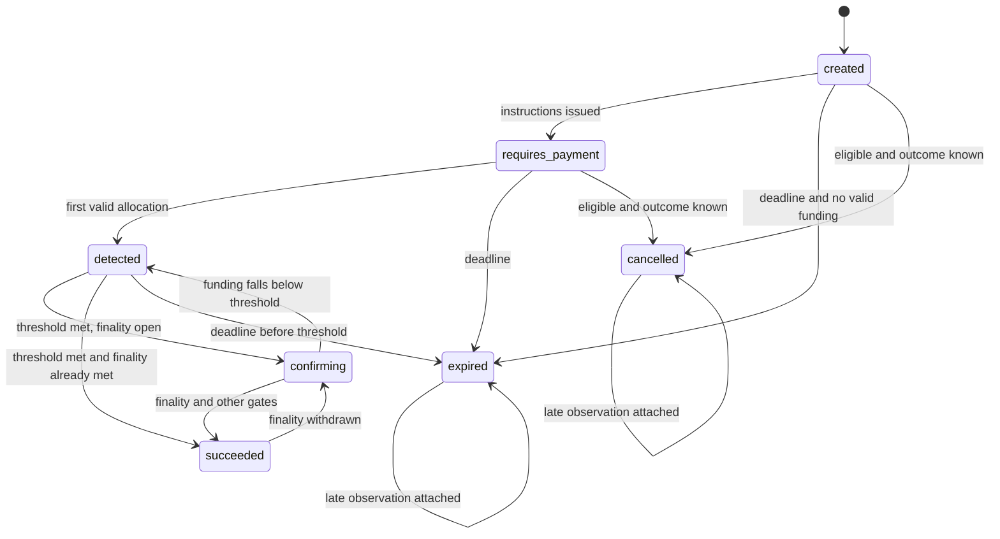

# Payment state machine

Acceptance status is only one dimension. Exception flags, compliance posture, provider-attempt outcome and settlement posture move independently (ADR-010). Projections are derived from append-only evidence (ADR-008). This specification is the contract for slices 3, 5, 6, 9, 10 and 11.

The prototype’s `PaymentStatus` omits `created` and starts at `requires_payment` because `createIntent` issues instructions in the same function. Production must not do that.

## Acceptance status

| Status | Meaning |
| --- | --- |
| `created` | The business obligation is durable. No payment option has issued instructions, or issuance is still unresolved. |
| `requires_payment` | At least one option has issued instructions. No valid allocated amount has been recognized yet. |
| `detected` | At least one valid transfer is allocated, and the recognized amount is still below the acceptance threshold. |
| `confirming` | The recognized amount meets the acceptance threshold, and chain finality for the contributing observations is not yet satisfied. |
| `succeeded` | Funding, finality, compliance and provider-outcome gates are all satisfied. |
| `expired` | The expiry deadline passed before success. Terminal for new acceptance. Monitoring stays on. |
| `cancelled` | An authorized cancellation completed. Terminal for new acceptance. Monitoring stays on. |

`expired` and `cancelled` are terminal acceptance statuses. They are not a reason to drop late observations.

## Allowed transitions

A transition commits only with its evidence. Guards are evaluated inside the same database transaction as the projection update.

| From | To | Guard |
| --- | --- | --- |
| `created` | `requires_payment` | At least one option is `issued`. Its attempt outcome is `committed`. Compliance is not `blocked` or `held`. |
| `created` | `expired` | Expiry deadline has passed and recognized valid amount is zero. |
| `created` | `cancelled` | Caller is authorized. No valid allocation. Every attempt is `not_attempted`, `known_not_committed`, or `failed_before_commit`. None is `prepared` or `unknown`. |
| `requires_payment` | `detected` | A valid allocation is posted and the recognized amount is still below the threshold. |
| `requires_payment` | `expired` | Deadline passed and threshold is not met. |
| `requires_payment` | `cancelled` | Same cancellation guard as `created`, and recognized valid amount is zero. Issued instructions remain stored. |
| `detected` | `confirming` | Recognized valid amount of one asset meets the threshold. Contributing observations are not final under the snapshotted policy. |
| `detected` | `succeeded` | Threshold, finality, compliance clear, no `unknown` attempt, and no open reorganization review are already true in the same evaluation. |
| `detected` | `expired` | Deadline passed before the threshold was met. Existing allocations stay attached. |
| `confirming` | `succeeded` | Finality policy is satisfied for every observation that contributes to the threshold. Compliance is `clear`. No attempt is `unknown`. Reorganization review is not open. Recognized amount still meets the threshold. |
| `confirming` | `detected` | A compensating event drops recognized valid amount below the threshold. |
| `succeeded` | `confirming` | Finality of a contributing observation is withdrawn, or a compensating event removes value that the threshold requires. Prior success evidence stays in the journal. |
| `expired` | `expired` | A new observation is attached. Status text does not change. |
| `cancelled` | `cancelled` | A new observation is attached. Status text does not change. |

There is no transition from `expired` or `cancelled` to `succeeded`. An authorized acceptance review, if a later approved procedure defines one, is a new compliance and acceptance decision with its own evidence. It is not a status overwrite, and it is not in the MVP console as a force-finalize control. The prototype correctly refuses finality while a late-transfer review flag is set; production keeps that refusal.

## Forbidden transitions

These are rejected and leave the projection unchanged.

- Any status to a previous status by editing the row in place. The only backward projections are `confirming` to `detected` and `succeeded` to `confirming`, and both require a new compensating event.
- `succeeded`, `expired`, or `cancelled` to `created` or `requires_payment`.
- `expired` or `cancelled` to `detected`, `confirming`, or `succeeded` because a late transfer arrived.
- `succeeded` while compliance is `held`, `blocked`, `unavailable`, or `not_evaluated`.
- `succeeded` or `cancelled` while any attempt for issued instructions is `prepared` or `unknown`.
- `succeeded` while reorganization review is open.
- `succeeded` by summing amounts across different contracts, chain IDs, or assets.
- Deleting an option, instruction, observation, route decision, or financial event to represent expiry, cancellation, reorg, or correction.
- Changing the provider or destination of an option after its instructions are `issued`.

## Acceptance threshold

The threshold is the obligation amount minus the merchant’s configured tolerance for that asset. Tolerance is an exact minor-unit amount from a versioned policy.

**Development default:** tolerance is zero. The recognized amount must be greater than or equal to the obligation. This matches the prototype’s full-funding check and is not an approved merchant policy.

Underpayment and overpayment are exception flags. They are not acceptance statuses. An underpaid intent stays in `detected` even if confirmations grow. The prototype moves an underpaid intent to `confirming` when the confirm scenario runs; production does not, because `confirming` means the funding threshold is already met.

## Exception flags

Flags accumulate. Clearing a flag appends a decision; it does not rewrite the event that raised it.

| Flag | When set | Effect on success |
| --- | --- | --- |
| `underpayment` | Recognized valid amount is below the threshold after at least one valid allocation | Success blocked until further valid funding meets the threshold |
| `overpayment` | Recognized valid amount for the asset exceeds the obligation | Does not by itself block success. No automatic refund. Stays visible for investigation |
| `late_transfer` | A valid or invalid observation arrives after `expired` or `cancelled` | Blocks automatic success |
| `wrong_token` | Contract is not the option’s allowlisted contract | Unallocated. Never increases recognized amount |
| `wrong_chain` | Chain ID is not the option’s chain | Unallocated. Never increases recognized amount |
| `unallocated` | Destination, transfer topic, or asset identity failed validation | Retained for reconciliation. Not credited |
| `reorganization_review` | An observation is orphaned or replaced | Blocks success and reopens finality when success had been reached |

Duplicate delivery is not a flag and not a second credit. The inbox records the duplicate.

Wrong-token and wrong-chain observations keep their own contract, chain ID, decimals and raw amount. The prototype’s unallocated journal line still says “USDC”. Production must not relabel them with the obligation asset.

## Compliance posture

| Posture | Meaning |
| --- | --- |
| `not_evaluated` | A required check has not completed |
| `clear` | The snapshotted policy passed and the decision is fresh |
| `held` | Investigation or an unresolved mandatory result. Case reference required when a case exists |
| `blocked` | Policy prohibits the corridor, asset, party, or amount |
| `unavailable` | The screening source timed out, is stale, or is down. Treated as fail-closed |

`unavailable` and missing mandatory checks block new instruction issuance and block success. They do not block ingestion of observations that already happened. There is no unrestricted release-hold action. Moving from `held` or `unavailable` to `clear` requires a new compliance decision under the role policy in slice 8.

The prototype’s `hold` boolean and fixed `CASE-1042` string are a single fixture. Production stores source, timestamp, policy version, freshness, outcome and case reference (CMP-004).

## Provider-attempt outcome

| Outcome | Meaning | Fallback | Cancellation |
| --- | --- | --- | --- |
| `not_attempted` | No call has been prepared | Not applicable | Allowed if the other cancellation guards pass |
| `prepared` | Attempt row committed; call not resolved | Forbidden | Forbidden |
| `failed_before_commit` | Local validation or gate failure before the call | A new attempt is allowed after revalidation | Allowed |
| `known_not_committed` | Provider authoritatively rejected with no commitment | A new attempt is allowed after revalidation | Allowed |
| `committed` | Provider acknowledged these instructions | Forbidden for this option | Allowed only when recognized valid amount is still zero. Instructions stay stored |
| `unknown` | Timeout, loss, or ambiguous response, including a crash after `prepared` | Forbidden | Forbidden |

The attempt protocol is ADR-011. Reconciliation of `unknown` uses the original correlation reference and may result in `committed` or `known_not_committed`. It must not create another attempt.

## Settlement posture

| Posture | Meaning |
| --- | --- |
| `pending` | No matching external settlement evidence |
| `settled` | External evidence matched the recognized amount under the statement rules |
| `mismatch` | External evidence conflicts with recognized amount, identity, or a later compensating event |
| `exception` | Missing, duplicate, excess, or unknown statement evidence retained for investigation |

Payment `succeeded` does not set settlement to `settled`. The prototype’s “Record matched statement” control is a simulated external confirmation and is not a production action.

A reorg after `settled` appends a mismatch or exception. It does not delete the statement row. Identical statement imports with the same provider reference and payload are no-ops. The same reference with a different payload is a conflict. A correction uses a new provider reference and new evidence.

## Payment options and quotes

One intent is one business obligation. It may have several payment options, each with one asset, chain, contract, destination and provider attempt. Recognized amounts are not summed across assets or contracts.

Option status is `draft`, `issuing`, `issued`, or `issuance_unknown`. Options are not deleted when the intent expires or is cancelled. `issued` instructions stay readable, including the historical route decision.

Amount semantics:

- **Fixed token:** the client sends the asset, chain and a decimal amount. The server parses that string at the asset’s scale.
- **Fiat-denominated:** the client sends a fiat currency and amount plus a quote reference. Without a certified quote source, the API rejects this shape with a non-retryable `quote_required` error. The server never treats USD and a stablecoin as 1:1.

The PRD’s illustrative create body uses `currency: USD` and `amount: "250.00"`. The prototype stores that kind of input as six-decimal token units. Those are different contracts. Slice 6 publishes both shapes and enables only fixed-token acceptance until a quote provider is approved. Executable quotes are P1.

## Idempotency and recognition

API idempotency for financial mutations is scoped by environment, authenticated tenant, and idempotency key. The client does not supply the tenant. The comparison payload is a canonical encoding of the normalized request, with decimal amounts rewritten at asset scale. The same payload replays the stored response. A different payload returns `idempotency_conflict` and does not change state. Concurrent requests are serialized by a database unique constraint. An in-flight request does not start a second financial effect. Idempotency records live as long as the financial evidence they created. A short TTL that would allow the same key to create another intent is forbidden.

Observation identity is `(chain_id, transaction_hash, log_index)`. Recognition of that observation against one payment option happens in one transaction. A second chain event or provider callback for the same identity posts no additional amount.

## Concurrency

Intent projections carry a version. A writer updates the projection only if the version matches, or retries against the new journal. Limit consumption and observation insertion use database constraints so two workers cannot both consume the same headroom or both credit the same log.

## Webhook signals

Status transitions and exception, compliance, unknown-outcome and settlement changes enqueue logical events after the same transaction commits them to the outbox. Event names follow the PRD: `payment_intent.created`, `payment_detected`, `confirming`, `succeeded`, `expired`, `cancelled`, exception events, and `settlement.created`, `settlement.completed`, `settlement.failed`. Refund event names are P1 and are not emitted.

A transition that is forbidden does not emit a success or cancellation event.
